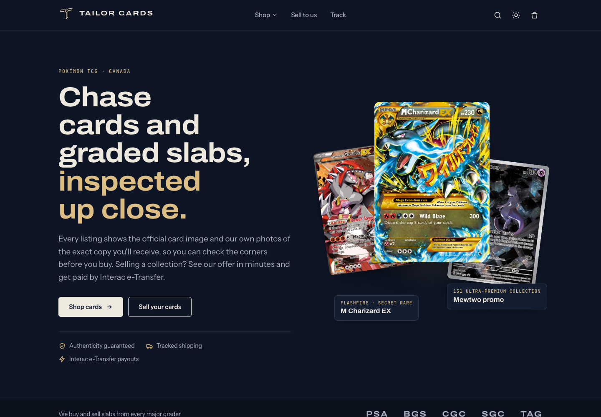
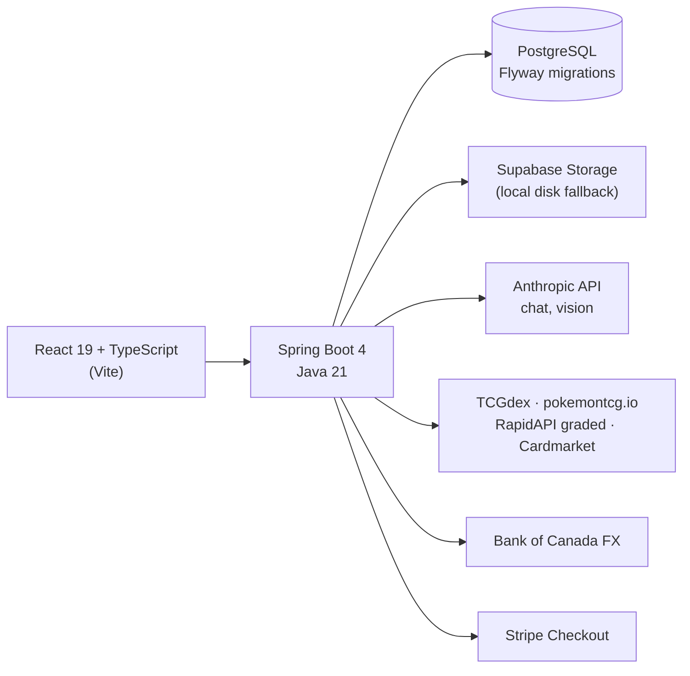

<h1 align="center">Tailor Cards</h1>

<p align="center">
  A Pokémon card store with an AI buylist: shop singles, slabs and sealed product, or sell your collection by chatting or scanning cards with your phone.
</p>

<p align="center">
  <a href="https://tailorcards.com"><b>tailorcards.com</b></a> ·
  <a href="https://tailor-cards-api.onrender.com/swagger-ui/index.html">API docs</a> ·
  <a href="docs/ai-buylist.md">AI buylist</a> ·
  <a href="docs/listing-generator.md">Listing generator</a>
</p>

<p align="center">
  
</p>

## Features

**Shop**
- Catalog of singles, graded slabs and sealed product with filters, search and a quick view.
- Every listing shows the official card image plus the store's own photos of the exact copy.
- Guest cart with no account needed; Stripe Checkout with stock checked before payment and again when the payment lands.
- Light and dark themes.

**Sell to us (AI buylist)**
- Customers list cards by chatting, pasting a list or uploading a CSV, and see the store's offer at its published rates.
- **Card scanner:** point a phone camera at a card. Live guidance (light, glare, focus, framing) takes the photo automatically, then a vision model identifies the card and estimates its condition. Nothing is added until the customer confirms. On a computer, a QR code moves the scan to the customer's phone, and cards scanned there appear on the computer's list.
- Sell for cash, trade for shop cards, or both, with an estimated approval rating that explains what would raise it.
- Every submission is reviewed by a person in the admin queue.

**Admin**
- Buylist queue with the transcript, prices, photos and red flags for each submission.
- Listing generator: photos of a card become an editable product draft.
- Product photos, card linking for official images, and editable buy rates.

## How the AI is kept honest

The language model never sets a price. It talks to the customer and turns messy text or photos into structured items; everything with money in it is plain Java.

| The model does | Java does |
| :--- | :--- |
| Chat, and normalise card names, sets, numbers and conditions | Match cards against TCGdex by set and number |
| Read card photos: name, number, condition estimate | Price them: TCGplayer market, Cardmarket 30-day average, eBay graded sales |
| Explain the offer to the customer | Apply buy rates, limits and the approval estimate |
| Call read-only lookup tools and edit the customer's own draft | Create the submission, only from the Confirm button |

Customer messages, CSV cells, card text and photo contents are treated as untrusted data. Replies are checked for leaked instructions, and model output is validated against a schema before use.

Changes to the assistant are measured with an **evaluation harness**: 40 labelled conversations run through the production prompt, tools and model, scored on outcomes (did the right card, grade and quantity end up on the list?) with a regression gate against a saved baseline. See [docs/ai-buylist.md](docs/ai-buylist.md#evaluation).

## Buy rates

Rates are rows in the `buy_rules` table, editable in the admin, and shown to customers as they are.

| Item | Cash |
| :--- | ---: |
| PSA 10 / BGS Black Label | 82% |
| Near mint | 77% |
| Sealed product | 70% |
| LP+ (near mint with one white dot) | 65% |
| Lightly played | 60% |
| Moderately played | 40% |
| Heavily played | 20% |
| Damaged | 10% |
| Anything else | 75% |

Store credit is 80% of market value; played and damaged cards get their cash rate plus the same trade bonus.

## Architecture



| Layer | Stack |
| :--- | :--- |
| Backend | Java 21, Spring Boot 4.1, Spring Security, Spring Data JPA, Flyway, SpringDoc OpenAPI |
| Frontend | React 19, TypeScript, Vite, React Router |
| Data | PostgreSQL (Supabase in production), Supabase Storage |
| AI | Anthropic Messages API (Claude Haiku 4.5 by default), tool use and vision |
| Payments | Stripe Checkout with signed webhooks |
| Hosting | Render (Docker backend, static frontend), see [`render.yaml`](render.yaml) |

A few decisions worth knowing about:
- **Optimistic locking** (`@Version` on `Product`) so two buyers can't both check out the last copy of a card; the loser gets a clean 409.
- **Flyway with `ddl-auto=validate`.** Production was baselined at V1, so every later migration is idempotent and tested against a dump of the production schema.
- **Prices in CAD, stored in USD.** Market data is USD (TCGplayer) or EUR (Cardmarket); customers see CAD at the daily Bank of Canada rate.
- **Latency budget.** A 60-card lot is matched and priced in about 16 s (from 35 s), checked by a benchmark test that also fails if any price changes. See [docs/performance.md](docs/performance.md).
- **Card scanner checks run in the browser.** Edge, light, glare and focus checks take about a millisecond per frame, so customers get instant feedback and only good photos reach the vision model.

## Running locally

**Requirements:** Java 21, Node 20+, PostgreSQL (or Docker).

```bash
docker run -d --name tc-local-pg -e POSTGRES_DB=tailorcards -e POSTGRES_PASSWORD=postgres -p 5433:5432 postgres:17
```

```bash
export DB_PORT=5433 DB_NAME=tailorcards DB_PASSWORD=postgres ADMIN_PASSWORD=change-me
./mvnw spring-boot:run
```

```bash
cd frontend && npm install && npm run dev
```

The backend runs on `http://localhost:8080` (Swagger UI at `/swagger-ui/index.html`) and the site on `http://localhost:5173`. Flyway creates and seeds the schema on first start.

### Environment

Only the database settings and `ADMIN_PASSWORD` are required. Everything else switches a feature on.

| Variable | Purpose |
| :--- | :--- |
| `DB_HOST`, `DB_PORT`, `DB_NAME`, `DB_USERNAME`, `DB_PASSWORD` | PostgreSQL connection |
| `ADMIN_USERNAME`, `ADMIN_PASSWORD` | Admin login |
| `STRIPE_SECRET_KEY`, `STRIPE_WEBHOOK_SECRET` | Checkout |
| `ANTHROPIC_API_KEY` | AI buylist chat, card scanner, listing generator |
| `CHATBOT_ENABLED` | `true` turns the AI buylist on at `/sell` |
| `RAPIDAPI_KEY` | Graded card prices (median of recent eBay sales) |
| `FRONTEND_URL` | Where Stripe sends customers after checkout |

The full list, including email, Turnstile, spend limits and storefront settings, is in [docs/ai-buylist.md](docs/ai-buylist.md#configuration) and [`application.yaml`](src/main/resources/application.yaml).

## Tests

```bash
./mvnw test                      # backend: unit, integration, migration and concurrency tests
cd frontend && npm run build     # type check and production build
```

The AI evaluation calls the real model, so it runs on demand instead of on every push:

```bash
ANTHROPIC_API_KEY=... ./evaluation/run_buylist_eval.sh --repeats 3
```

CI runs the backend and frontend checks on every push and pull request; the live evaluation runs weekly in GitHub Actions.

## Deployment

[`render.yaml`](render.yaml) describes the whole stack: the Dockerised API, the static frontend and the database. Pushing to `main` deploys. Setting `DEMO_MODE=true` on a separate deployment seeds sample data and a read-only demo admin that can only see demo records; production never loads either.

## Documentation

- [AI buylist and card scanner](docs/ai-buylist.md): flow, pricing sources, approval estimate, limits, configuration, evaluation
- [Listing generator](docs/listing-generator.md): photo-to-draft for admins
- [AI buylist latency](docs/performance.md): where the time goes, before/after timings, the benchmark and production queries
- [Trade pricing engine](docs/trade-pricing-engine.md): the deterministic engine behind `/api/trade-assistant`
