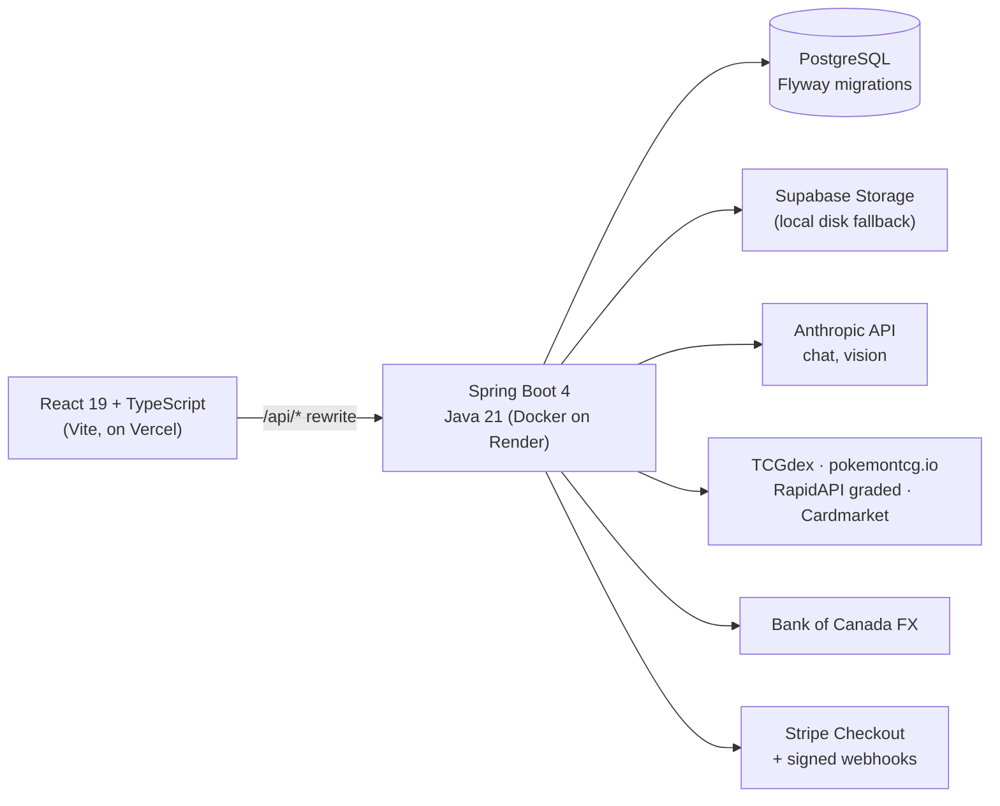

<h1 align="center">Tailor Cards</h1>

<p align="center">
  A Pokémon card store with an AI buylist: shop singles, slabs and sealed product, or sell your collection by chatting, pasting a list or scanning cards with your phone.
</p>

<p align="center">
  <a href="https://github.com/hrishi-tailor/Tailor-Cards/actions/workflows/ci.yml"></a>
  
  
  
  
</p>

<p align="center">
  <a href="https://tailorcards.com"><b>tailorcards.com</b></a> ·
  <a href="https://tailor-cards-api.onrender.com/swagger-ui/index.html">API docs</a> ·
  <a href="docs/ai-buylist.md">AI buylist</a> ·
  <a href="docs/listing-generator.md">Listing generator</a>
</p>

<p align="center">
  
</p>

> **Status:** the store is live at [tailorcards.com](https://tailorcards.com) and takes real orders. The AI buylist is in a private beta with repeat customers.

## Contents

- [Why it exists](#why-it-exists)
- [Features](#features)
- [How the AI is kept honest](#how-the-ai-is-kept-honest)
- [Engineering decisions](#engineering-decisions)
- [Architecture](#architecture)
- [Project layout](#project-layout)
- [Running locally](#running-locally)
- [Tests and CI](#tests-and-ci)
- [Security](#security)
- [Deployment](#deployment)
- [Buy rates](#buy-rates)
- [Documentation](#documentation)

## Why it exists

Tailor Cards started as a one-person business selling cards on Instagram, Facebook, eBay and at card shows. Two things didn't scale by hand: selling one-of-a-kind cards without double-booking them, and pricing the collections people want to sell, which means looking up every card. This repository is the answer to both: a store with real checkout, and a buylist that prices a whole list of cards consistently while a person still approves every deal.

## Features

**Shop**
- Catalog of singles, graded slabs and sealed product with filters, search and a quick view.
- Every listing shows the official card image plus the store's own photos of the exact copy.
- Guest cart with no account needed; Stripe Checkout with stock checked before payment and again when the payment lands.
- Light and dark themes.

**Sell to us (AI buylist)**
- Customers list cards by chatting, pasting a list or uploading a CSV (up to 1,000 lines), and see the store's offer at its published rates.
- **Card scanner:** point a phone camera at a card. Live guidance (light, glare, focus, framing) takes the photo automatically, then a vision model identifies the card and estimates its condition. Nothing is added until the customer confirms. On a computer, a QR code moves the scan to the customer's phone, and cards scanned there appear on the computer's list.
- Sell for cash, trade for shop cards, or both, with an estimated approval rating that explains what would raise it.
- Every submission is reviewed by a person in the admin queue.

**Admin**
- Ledger of purchases and sales: revenue, profit, margin and days to sell by kind, channel and month, plus stock on hand at cost. History imports from CSV.
- Show mode: log card-show deals on a phone in a few taps, with an offline queue for halls with no signal.
- Buylist queue with the transcript, prices, photos and red flags for each submission.
- Listing generator: photos of a card become an editable product draft.
- Product photos, card linking for official images, and editable buy rates.

## How the AI is kept honest

The language model never sets a price. It talks to the customer and turns messy text or photos into structured items; everything with money in it is plain Java.

| The model does | Java does |
| :--- | :--- |
| Chat, and normalise card names, sets, numbers and conditions | Match cards against TCGdex by set and number |
| Read card photos: name, number, condition estimate | Price them: TCGplayer market, Cardmarket 30-day average, eBay graded sales |
| Explain the offer to the customer | Apply buy rates, limits and the approval estimate |
| Call read-only lookup tools and edit the customer's own draft | Create the submission, only from the Confirm button |

Customer messages, CSV cells, card text and photo contents are treated as untrusted data. Replies are checked for leaked instructions, and model output is validated against a schema before use. A daily spend ceiling pauses the model and falls back to the Java parser for pasted lists and CSVs.

Changes to the assistant are measured with an **evaluation harness**: 40 labelled conversations run through the production prompt, tools and model, scored on outcomes (did the right card, grade and quantity end up on the list?) with a regression gate against a saved baseline. See [docs/ai-buylist.md](docs/ai-buylist.md#evaluation).

## Engineering decisions

- **Optimistic locking** (`@Version` on `Product`) so two buyers can't both check out the last copy of a card; the loser gets a clean `409`.
- **Stock is checked twice:** once before the Stripe session is created and again when the signed webhook arrives, and repeated webhook deliveries for the same session are recorded once.
- **Flyway with `ddl-auto=validate`.** Production was baselined at V1, so every later migration is idempotent and tested against a dump of the production schema.
- **Prices in CAD, stored in USD.** Market data is USD (TCGplayer) or EUR (Cardmarket); customers see CAD at the daily Bank of Canada rate.
- **Latency budget.** A 60-card lot is matched and priced in about 16 s (from 35 s), checked by a benchmark test that also fails if any price changes. See [docs/performance.md](docs/performance.md).
- **Card scanner checks run in the browser.** Edge, light, glare and focus checks take about a millisecond per frame, so customers get instant feedback and only good photos reach the vision model.
- **Rates are data, not code.** Buy rates and trade parameters live in database tables the owner edits in the admin, so a pricing change never needs a deploy.

## Architecture



| Layer | Stack |
| :--- | :--- |
| Backend | Java 21, Spring Boot 4.1, Spring Security, Spring Data JPA, Flyway, SpringDoc OpenAPI |
| Frontend | React 19, TypeScript, Vite, React Router |
| Data | PostgreSQL (Supabase in production), Supabase Storage |
| AI | Anthropic Messages API (Claude Haiku 4.5 by default), tool use and vision |
| Payments | Stripe Checkout with signed webhooks |
| Hosting | Backend: Docker on Render. Frontend: Vercel. See [Deployment](#deployment) |

## Project layout

```text
src/main/java/com/tailorcards/
├── api/
│   ├── buylistchat/     AI buylist: chat, intake, card resolution, pricing, scanner, email codes
│   ├── ledger/          Purchases and sales ledger, results summary, CSV import
│   ├── listing/         Listing generator (photos to product draft)
│   ├── pipeline/        Signed endpoints for the AWS price pipeline
│   ├── trade/           Deterministic trade pricing engine (legacy, see docs)
│   ├── controller/      REST controllers for products, admin and buylist
│   ├── service/         Catalog, prices, photos, exchange rates
│   ├── entity/ dto/ mapper/ repository/
│   ├── security/ config/ exception/
│   └── demo/            Demo-mode seeding and read-only demo admin
├── controller/          Stripe checkout endpoint and webhook
└── service/             Stripe checkout and order processing
src/main/resources/db/migration/   Flyway migrations
frontend/                          React app (Vite)
evaluation/                        AI evaluation harness, scenario suite and trade backtester
pipeline/                          Nightly price pipeline (Python Lambda) and its tests
infra/                             Terraform for the AWS staging environment
docs/                              Feature documentation
```

## Running locally

**Requirements:** Java 21, Node 20+, PostgreSQL (or Docker).

```bash
docker run -d --name tc-local-pg -e POSTGRES_DB=tailorcards -e POSTGRES_PASSWORD=postgres -p 5433:5432 postgres:17
```

```bash
export DB_PORT=5433 DB_NAME=tailorcards DB_PASSWORD=postgres ADMIN_PASSWORD=change-me TOTP_ENCRYPTION_KEY="$(openssl rand -base64 32)"
./mvnw spring-boot:run
```

```bash
cd frontend && npm install && npm run dev
```

The backend runs on `http://localhost:8080` (Swagger UI at `/swagger-ui/index.html`) and the site on `http://localhost:5173`. Flyway creates and seeds the schema on first start.

### Environment

Only the database settings and `ADMIN_PASSWORD` are required; the app refuses to start without an admin password. Everything else switches a feature on.

| Variable | Purpose |
| :--- | :--- |
| `DB_HOST`, `DB_PORT`, `DB_NAME`, `DB_USERNAME`, `DB_PASSWORD` | PostgreSQL connection |
| `ADMIN_USERNAME`, `ADMIN_PASSWORD` | Admin login |
| `TOTP_ENCRYPTION_KEY` | Required: encrypts admins' two-factor secrets (`openssl rand -base64 32`). See [docs/security.md](docs/security.md) |
| `STRIPE_SECRET_KEY`, `STRIPE_WEBHOOK_SECRET` | Checkout |
| `ANTHROPIC_API_KEY` | AI buylist chat, card scanner, listing generator |
| `CHATBOT_ENABLED` | `true` turns the AI buylist on at `/sell` |
| `RAPIDAPI_KEY` | Graded card prices (median of recent eBay sales) |
| `FRONTEND_URL` | Where Stripe sends customers after checkout |
| `PIPELINE_SHARED_SECRET` | Turns on the signed endpoints for the AWS price pipeline (`openssl rand -hex 32`, same value as its Secrets Manager secret). See [docs/price-pipeline.md](docs/price-pipeline.md) |
| `PRICE_SNAPSHOT_SOURCE` | `pipeline` stops the app's own 3 AM price job where the AWS pipeline records prices (default `app`) |

The full list, including email, Turnstile, spend limits and storefront settings, is in [docs/ai-buylist.md](docs/ai-buylist.md#configuration) and [`application.yaml`](src/main/resources/application.yaml).

## Tests and CI

```bash
./mvnw test                      # backend: 350+ unit, integration, migration and concurrency tests
cd frontend && npm run build     # type check and production build
cd pipeline && uv run --group dev pytest   # price pipeline (Python)
```

Integration tests run against a real PostgreSQL container (Testcontainers), including migration tests against a dump of the production schema.

[GitHub Actions](.github/workflows/ci.yml) runs the backend tests and the frontend lint and build on every push to `main` and every pull request.

The AI evaluation calls the real model, so it runs weekly and on demand ([`buylist-eval.yml`](.github/workflows/buylist-eval.yml)) instead of on every change:

```bash
ANTHROPIC_API_KEY=... ./evaluation/run_buylist_eval.sh --repeats 3
```

## Security

- **No secrets in the repository.** Every key comes from the environment; the app refuses to boot without `ADMIN_PASSWORD`.
- **Roles:** Spring Security separates public, customer and admin routes. A demo deployment gets a read-only admin that can only see demo records.
- **Payments:** Stripe webhooks are verified by signature, and repeated deliveries are recorded once.
- **AI buylist:** anonymous sessions are rate limited per IP, with optional Cloudflare Turnstile and emailed one-time codes (HMAC-hashed, expiring, attempt-limited). One submission per email per day, and a person approves every deal.
- **Uploads:** photos are checked by content type and size and stripped of metadata (EXIF, including GPS) before they reach the vision model.
- **Model spend:** per-session rate limits and a daily spend ceiling.

Details for each control are in [docs/ai-buylist.md](docs/ai-buylist.md) and [docs/listing-generator.md](docs/listing-generator.md).

## Deployment

Production runs as three pieces:

| Piece | Where | Config |
| :--- | :--- | :--- |
| API (Spring Boot, Docker) | Render, `tailor-cards-api.onrender.com` | [`Dockerfile`](Dockerfile), [`render.yaml`](render.yaml) |
| Frontend (React build) | Vercel, `tailorcards.com` | [`frontend/vercel.json`](frontend/vercel.json) rewrites `/api/*` to the Render API |
| Database and photo storage | Supabase | Connection settings come from the environment |

[`render.yaml`](render.yaml) is a Render Blueprint that can also stand up a self-contained copy of the stack (API, static frontend and a Render PostgreSQL database), which is handy for a demo deployment. Setting `DEMO_MODE=true` on such a deployment seeds sample data and a read-only demo admin that can only see demo records; production never loads either.

## Buy rates

Rates are rows in the `buy_rules` table, editable in the admin, and shown to customers as they are.

| Item | Cash |
| :--- | ---: |
| PSA 10 / BGS Black Label | 82% |
| PSA 9 | 78% |
| Near mint | 77% |
| Sealed product | 70% |
| LP+ (near mint with one white dot) | 65% |
| Lightly played | 60% |
| Moderately played | 40% |
| Heavily played | 20% |
| Damaged | 10% |
| Anything else | 75% |

Store credit is 80% of market value; played and damaged cards get their cash rate plus the same trade bonus.

## Documentation

- [AI buylist and card scanner](docs/ai-buylist.md): flow, pricing sources, approval estimate, limits, configuration, evaluation
- [Ledger and show mode](docs/ledger.md): how purchases and sales are recorded, the API, the CSV format, the offline queue and the test cases
- [Price pipeline](docs/price-pipeline.md): the nightly AWS Lambda that prices stock from TCGdex into an S3 data lake, its signed API, alarms, runbook and test cases
- [Warehouse](docs/warehouse.md): the nightly Glue/Athena star schema, marts, data-quality checks and their DuckDB tests
- [Listing generator](docs/listing-generator.md): photo-to-draft for admins
- [AI buylist latency](docs/performance.md): where the time goes, before/after timings, the benchmark and production queries
- [Security](docs/security.md): admin two-factor login, lockout, headers, audit log, upload checks, scanning in CI
- [Trade pricing engine](docs/trade-pricing-engine.md): the deterministic engine behind `/api/trade-assistant` (legacy; the AI buylist replaced its customer page)
